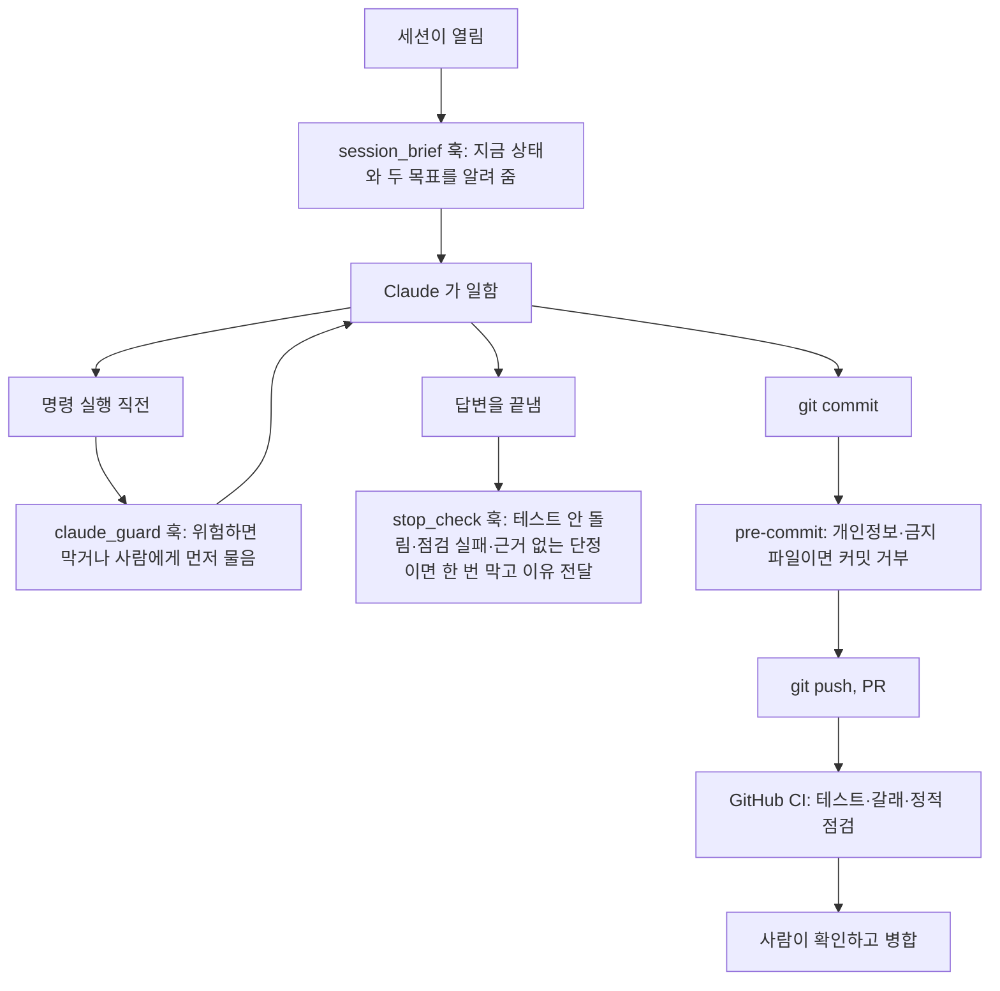
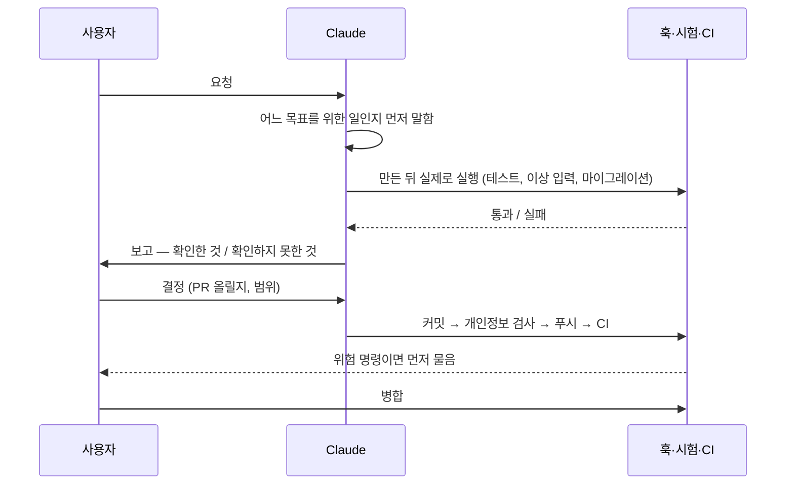

# 하네스 엔지니어링 설명서 — LLM 과 일할 때 목표를 지키는 법

작성 2026-11-09 · 이 프로젝트(지역아동센터 웹, Django)에서 실제로 만들고 돌려 본 것을 기준으로 쓴 설명서다.
노션에 마크다운으로 가져오기 하면 된다. 도식은 mermaid 코드로 넣었다. 사용자가 노션으로 가져와 **mermaid 도식이 그림으로 그려지는 것을 확인했다**(2026-11-09). 반대로 SVG·PNG 그림 파일은 마크다운 가져오기에서 따라오지 않았다 — 그래서 도식은 그림 파일이 아니라 mermaid 로만 둔다.

---

## 1. 한 줄 요약

LLM 에게 "잘 해 줘"라고만 하면 목표에서 벗어나고, 근거 없이 말하고, 돌려 보지 않고 "괜찮다"고 한다.
그래서 **말로 부탁하지 않고, 일하는 환경에 장치를 건다.** 그 장치 모음이 하네스(harness, 말의 마구)다.

장치는 네 가지다.

| 축 | 하는 일 | 이 프로젝트의 것 |
|---|---|---|
| 지침 | 목표와 규칙을 글로 박아 둔다. 새 세션이 열릴 때마다 읽힌다 | `CLAUDE.md` |
| 자동 점검 | 사람 기억에 맡기지 않고 프로그램이 검사한다 | 훅, git pre-commit, CI, `/verify` |
| 기억 | 대화가 바뀌어도 남겨야 할 것을 저장한다 | 메모 파일, `docs/확인사항.md`(열린 항목만) |
| 사람 확인 | 사람이 정해야 하는 지점에서 멈추고 묻는다 | 훅의 "먼저 묻기", 보고 끝의 질문 |

---

## 2. 왜 필요한가 — LLM 의 약점 세 가지

1. **목표 이탈**: 대화가 길어지면 처음 목적이 흐려지고, 요청하지 않은 것을 만든다
2. **근거 없는 말**: 기억에 의존해 숫자·버전·정책을 단정한다
3. **안 돌려 보고 "괜찮다"**: 실행해 보지 않고 "통과했다 / 안전하다 / 문제없다"고 보고한다

이 프로젝트에서 실제로 있었던 일이다 (2026-11-05 ~ 11-09, 모두 이 저장소의 기록이나 명령 출력으로 확인한 것).

| 일어난 일 | 어떤 약점 | 이후 생긴 장치 |
|---|---|---|
| 개인 이메일과 사용자 폴더 경로가 문서에 들어가 병합됨 | 3 (확인 없이 올림) | 개인정보 검사(`check_leaks.sh`) + pre-commit + CI |
| 새 시드 명령을 실수로 사용자의 로컬 DB 에 돌려 데이터가 섞임 | 1 (범위 이탈) | 로컬 DB 를 바꾸는 명령은 훅이 먼저 묻기 |
| 처음 만든 검사 스크립트가 **실패해도 성공(종료 코드 0)** 이라고 했고, 한글 파일 이름을 통째로 건너뜀 | 3 | 스크립트 자체의 시험 (사고가 난 커밋에 돌려 실패하는지 확인) |
| 답변에서 "안전합니다"라고 단정했다가 지적받음 | 2 | 종료 훅의 단정 표현 경고, 보고 형식("확인한 것 / 못 한 것") |
| 훅이 문서에 적힌 글자 하나에 오탐해서 정상 명령을 막음 | (장치의 부작용) | 훅 시험에 오탐 사례 추가 |
| 팀에 보낼 답안지가 연습용 저장소에 섞여 있었음 | 1 | 갈래 검사(`check_track.py`) |

---

## 3. 일하는 순간마다 어디에 장치가 걸리는가

핵심: 훅은 Claude 에게 "말로 타이르는" 장치가 아니다. Claude Code 앱이 Claude 가 도구를 쓰는 **순간마다 사용자 컴퓨터에서 작은 프로그램을 자동 실행**하고,
그 결과(막기·묻기·메시지)가 Claude 에게 전달된다. 행동 앞에 서 있는 경비원이다.

**한계**: 경비원이 확실히 막는 것은 *행동*(위험 명령, 개인정보 커밋)이다. *말*(환각, 근거 없는 단정)은 문장 모양으로 거칠게 경고할 뿐이라 약하다.
그래서 "말"은 지침(보고 형식)과 사람의 확인이 같이 필요하다.

---

## 4. 이 프로젝트의 하네스 목록

| 층 | 이름 | 하는 일 | 확인 상태 |
|---|---|---|---|
| 지침 | `CLAUDE.md` | 0절에 두 목표, 사람이 정하는 것 표, 근거 규칙, 하지 않을 것, 하네스 사용법 | 작성 당시 세션에서 읽힘 |
| 시작 훅 | `scripts/session_brief.py` | 세션이 열릴 때 브랜치·미커밋·마이그레이션·두 목표를 알려 줌 | 출력 형식과 시험 통과. 새 세션 시작 때 출력이 들어오는 것을 확인(2026-11-11) |
| 실행 전 훅 | `scripts/claude_guard.py` | 위험 명령을 막거나 먼저 물음 (대상은 5절과 `CLAUDE.md` 0절 표) | 막기는 작성 당시 세션에서 실제로 발동함(문서에 적힌 글자 하나에 오탐해 정상 명령이 막혔다). **나중에 추가한 "먼저 묻기" 규칙은 시험으로만 확인**하고 실제 세션에서는 아직 못 봤다 |
| 종료 훅 | `scripts/stop_check.py` | 코드를 고친 뒤 테스트 기록이 없거나, 빠른 점검이 실패하거나, 단정 표현이 있는데 "확인하지 못한 것"이 없으면 한 번 막고 이유를 Claude 에게 돌려준다 | 시험 통과, 실제 세션 기록 형식으로 판정 확인 |
| git 훅 | `.githooks/pre-commit` → `check_leaks.sh` | 이메일·전화번호·경로·키·금지 파일이 있으면 커밋 거부 | 실제 커밋 거부 확인 |
| 명령 | `/verify` → `scripts/verify.sh` | 테스트·마이그레이션·개인정보·갈래·목록 검사를 한 번에, "통과/실패"로 | 두 갈래에서 통과 확인 |
| 표 검증 | `scripts/test_decision_table.py` | 지침의 "사람이 정하는 것" 표와 훅이 어긋나면 실패 | 규칙을 빼 보면 실패함을 확인 |
| CI | `test.yml`, `track.yml`, `audit.yml` | 서버(GitHub)에서 같은 검사를 다시 | `test`·`track` 은 main 병합 커밋(#17·#19·#20·#21 등)에서 success 확인(2026-11-11). `audit` 은 실행 기록이 없다 |
| 기억 | 메모 파일, `docs/확인사항.md` | 대화가 바뀌어도 남겨야 할 것(결정, 외부 확인·결정 대기 항목) | 사용 중 |

---

## 5. 사람이 끼는 지점 (human-in-the-loop)

하네스의 목적은 사람을 없애는 것이 아니라 **사람이 꼭 정해야 할 순간에 확실히 멈추게 하는 것**이다.
지금 목록과 방식은 `CLAUDE.md` 0절의 표가 기준이다 (여기에 복사하면 어긋나므로 거기를 본다). 방식은 세 가지다.

- **훅**: 실행 전에 기계가 멈추고 묻는다 (타 저장소 푸시, DB 를 바꾸는 명령, 병합, main 직접 수정, 되돌리기 어려운 git)
- **대화**: Claude 가 먼저 묻기로 약속한 것 (목표·우선순위 변경, 어떤 항목을 심을지). 기계가 막지 못하므로 어긋나면 사람이 바로 말한다
- **문서 체크리스트**: 명령 모양이 없는 결정 (실제 정보로 전환)

표와 훅이 어긋나지 않게 시험이 지킨다: 표에 "훅"이라고 적힌 줄의 예시 명령이 실제로 걸리는지 확인한다.

---

## 6. 새 작업을 시킬 때 `CLAUDE.md` 를 이렇게 쓴다

새 작업을 시작할 때 LLM 에게 매번 말로 설명하는 대신, 아래 여섯 칸을 지침 파일에 한 번 적어 둔다.

| 칸 | 적을 것 | 이 프로젝트의 예 |
|---|---|---|
| 목표 | 이 저장소가 **왜** 있는가. 둘 이상이면 모두 | 0절: ① 안전한 껍데기 ② 팀 실습용 취약 표면 |
| 하지 않을 것 | 어겨서 사고가 났거나 날 것 | 3절: 실제 DB 커밋 금지, 실습본 인터넷 배포 금지, 답안지 포함 금지 |
| "됐다"의 기준 | 무엇을 확인해야 끝인가, 단정해도 되는 말은 | 2절: 직접 실행한 출력만 근거. 테스트 통과 ≠ 안전 |
| 사람이 정하는 것 | LLM 이 혼자 정하면 안 되는 결정 | 0절 표 |
| 작업 흐름 | 브랜치, PR, 확인, 기록 | 5절: 브랜치 → 시험 → PR → CI → 병합 |
| 기록 위치 | 작업 기록과 열린 항목을 어디에 두는가 | 작업 기록은 커밋·PR 본문, 열린 항목만 `docs/확인사항.md` (2026-11-11 바꿈 — 줄글이 쌓이면 낡은 문서가 된다) |

작성 요령
- 규칙만 쓰지 말고 **왜**를 한 줄 붙인다 (사고 사례가 있으면 그것). 이유가 있어야 새 상황에서도 따른다
- 말로만 있는 규칙은 어긴다. **어기면 사고가 나는 것은 훅이나 시험으로 옮긴다**
- 길게 쓰지 않는다. 절차는 명령(`/verify`)으로 옮기고 지침에는 원칙만 둔다

---

## 7. 작업 한 번의 사이클 (예: "공지 검색을 만들어 줘")

보고의 모양을 고정해 둔다. 이게 "안 돌려 보고 괜찮다고 말하는 것"을 가장 직접적으로 막는다.

- 확인한 것: 실행한 명령과 실제 결과 (숫자, 응답 코드)
- 확인하지 못한 것: 이번 점검이 보지 않는 것 (브라우저 화면, HTTPS, 실제 서버 실행 등)
- "안전하다 / 문제없다 / 완벽하다"는 쓰지 않는다. 점검한 범위만 말한다

---

## 8. 이 하네스의 한계 (그대로 알고 쓴다)

- 시험을 만든 쪽(LLM)이 놓친 곳은 시험도 놓친다. "시험 통과"는 LLM 이 짠 시험과 모의 데이터 안의 이야기다
- 훅은 짧은 옵션(`-n`)이나 `bash -c "..."` 로 포장된 명령을 못 본다. 개인정보 검사는 이메일·전화번호·경로 *모양*만 찾는다(이름·주소는 못 찾는다)
- 단정 표현 경고는 문장 모양만 본다. 작성 당시 세션의 긴 답변 81개에 돌려 보니 2개를 짚었다(둘 다 사용자 말의 인용). 아직 거칠다
- 주간 `audit` 워크플로의 실행 기록은 아직 없고, 종료 훅(`stop_check.py`)이 실제 세션 끝에서 도는지는 확인하지 못했다
- 하네스는 사람을 대신하지 않는다. 목표와 우선순위를 정하는 것은 끝까지 사람이다

---

## 9. 다른 프로젝트에 가져가는 최소 세트

1. 지침 파일에 **목표 한 문단 + 하지 않을 것 + "됐다"의 기준** (6절 표)
2. 사고가 나면 비싼 것 하나를 골라 **실행 전에 먼저 묻는 훅** (DB, 푸시, 삭제)
3. 커밋 전 **비밀·개인정보 검사** (git pre-commit, 같은 스크립트를 CI 에서도)
4. **한 번에 돌리는 점검 명령**(`/verify`)과 보고 형식("확인한 것 / 못 한 것")
5. 사고가 날 때마다 **그 사고를 막는 시험을 먼저 쓰고, 장치를 빼 보면 시험이 실패하는지** 확인

장치를 늘리는 것이 목적이 아니다. 목표에서 벗어나거나 근거 없이 말하는 일이 줄었는지로 판단한다.

---

## 10. 용어

| 말 | 뜻 |
|---|---|
| 하네스 | LLM 이 목표대로 일하게 하는 환경과 장치 전체 |
| 훅 | 특정 순간(명령 실행 전, 세션 시작, 답변 끝)에 자동으로 도는 작은 프로그램 |
| pre-commit | 커밋 직전에 git 이 자동으로 돌리는 검사 |
| CI | 코드를 올리면 서버가 자동으로 돌리는 검사 |
| 휴먼 인 더 루프 | 사람이 결정해야 하는 지점에서 자동 진행을 멈추고 묻는 방식 |
| 오탐 / 놓침 | 정상인데 막는 것 / 위험한데 지나가는 것. 줄이면 다른 쪽이 늘어서 맞바꿔야 한다 |
